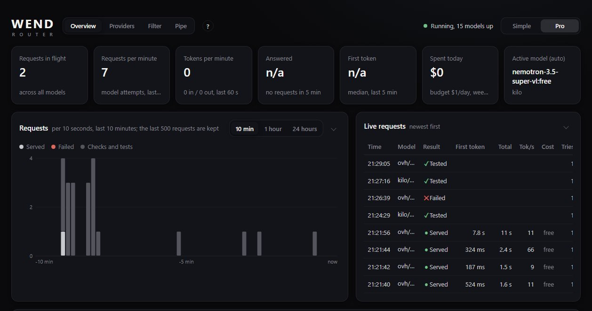

# Wend router

A free LLM router: one local endpoint, OpenAI- and Anthropic-compatible, in
front of many LLM providers. It keeps the models measured, sends each request
to the best one that is up and fits, and when a provider fails, runs out of
quota or stalls, it moves to another one on its own. Your agent never deals
with availability.

Free tiers first; paid models only when you allow them, within a budget.
Single Go binary, no dependencies, a dashboard built in.

> To *wend one's way*: to make one's way, going around what is in the road.



## Install

Linux or macOS:

```
curl -fsSL https://raw.githubusercontent.com/dklymentiev/wend-router/main/install.sh | sh
```

Windows, in PowerShell:

```
irm https://raw.githubusercontent.com/dklymentiev/wend-router/main/install.ps1 | iex
```

The script builds wend from source when Go 1.21 or newer is installed, runs it in
Docker when Docker is, and otherwise asks whether to download Go just for the build
or to take the ready binary. Everything goes into one folder, `~/wend`
(`%LOCALAPPDATA%\wend` on Windows), with no root or administrator rights. Then it
starts wend, sends one test request and opens the dashboard. The scripts are short;
read [install.sh](install.sh) or [install.ps1](install.ps1) first if you like.

Other ways:

- **With Go:** `go install github.com/dklymentiev/wend-router/cmd/wend@latest`.
  wend keeps its files next to the binary, so give it a folder of its own:
  `GOBIN=$HOME/wend go install ...`, then run `~/wend/wend`.
- **Ready binaries** for Linux, macOS and Windows are on the
  [releases page](https://github.com/dklymentiev/wend-router/releases), with
  `SHA256SUMS`. Put the file in a folder of its own and run it.
- **Docker**, from a clone of this repository: `docker compose up -d`. It listens on
  127.0.0.1:8888 and keeps everything it writes in the `wend-data` volume; keys go in
  on the dashboard, or in a `wend.env` next to `compose.yaml`.
- **From source**, in a clone: `go build -o wend ./cmd/wend` and `./wend`
  (`wend.exe` on Windows).

Open http://127.0.0.1:8888/dashboard. Add provider keys on the **Providers**
panel (stored encrypted in `keys.dat`), or put them in `wend.env` next to the
binary (see `wend.env.example`). Some providers work without a key, so the
router answers before you add any.

`wend version` prints the version, `wend help` lists every setting,
`wend models` lists the providers and models it found.

## Point an agent at it

Any agent that lets you set the API address works:

| Setting | Value |
|---|---|
| Base URL | `http://localhost:8888/v1` |
| API key | anything; the value of `ROUTER_TOKEN` when you set one |
| Model | a profile (`auto`, `fast`, `tools`, `vision`, `no-think`, `private`, or one you make) or a concrete `provider/model` |

```
OPENAI_BASE_URL=http://localhost:8888/v1
OPENAI_API_KEY=anything
model=auto
```

Python, `openai` package:

```python
from openai import OpenAI
client = OpenAI(base_url="http://localhost:8888/v1", api_key="wend")
client.chat.completions.create(model="auto", messages=[{"role": "user", "content": "hello"}])
```

Agents that speak the Anthropic API: `ANTHROPIC_BASE_URL=http://localhost:8888`
(no `/v1`). `/v1/messages` works with streaming and tool use; a `claude-*`
model name is served by the profile in `ROUTER_ANTHROPIC_PROFILE` (`auto` by
default).

The dashboard's **Connect your agent** section has ready snippets for common
tools.

More in [examples/](examples): curl, Python (`openai` and `anthropic`), Node,
and settings for coding agents such as Claude Code.

## How it picks a model

- Models come from each provider's live `/models` list. `seed.json` (built in)
  says which providers exist, which of their models are free and how strong
  they are; you can add any OpenAI-compatible server of your own.
- A prober sends a short request to untried and idle models, so the pool is
  measured before it is needed. A small test battery (tool calls, vision,
  JSON, instructions, reasoning) records what each model can actually do.
- A request is served only by what it asked for: a profile by its own
  models (and the reserves it names), `provider/model` by that one model, a
  bare model name by that model at any provider. When none of them can
  answer, the caller gets an error within seconds, never a model it did not
  ask for; an unknown name gets 404.
- Within that, each request goes to the first model that is up:
  pinned models first, then those whose last attempt worked, then untried
  ones, then ones that failed last; within those by strength or speed, as the
  profile says.
- Every upstream call is streamed. Until the first token arrives, a failing or
  silent model is swapped for the next one unnoticed, for streaming and
  non-streaming callers alike. How long a model may stay silent follows its
  usual speed; one that goes quiet midway is cut off after
  `ROUTER_STALL_TIMEOUT`.
- A profile can "also ask the next model": when the first has not started
  answering after a set time, the same request goes to the next model too,
  preferably at another provider, and the first to answer serves the caller.
- Quota errors pause a model until its reset time; repeated failures open a
  circuit breaker; refused or paid-only models are left alone for a while.
- Paid models are used only when a cost cap is set (`ROUTER_MAX_COST` or a
  profile's price limit), and then only after free ones, within
  `ROUTER_DAILY_BUDGET`.

## Profiles

A profile is what your agent asks for as the model. It says which models
qualify (tool calling, vision, reasoning, context size, speed, price, "does
not train on prompts", providers, name patterns), in which order to try them,
and which to pin first or keep last. New models that qualify join on their
own. Six come built in:

| Profile | Takes |
|---|---|
| `auto` | every model, strongest first |
| `fast` | every model, fastest first |
| `tools` | models that call tools |
| `vision` | models that read images |
| `no-think` | models that answer without a reasoning phase, fastest first |
| `private` | only providers that do not train on prompts |

Make your own on the dashboard; they are kept in `profiles.json`.

## Sessions and clients

A client that sends `X-Session-Id` keeps its conversation on one model while
that model answers; without it the router recognises a conversation by its
system prompt and first message. `X-Router-Client` names the client on the
dashboard (else the first word of its User-Agent). Both are optional.

## Dashboard

- `/dashboard` (Simple): what is running, providers and keys, profiles, and
  snippets to connect an agent.
- `/pro` (Pro): every model with its state, speed, reliability and test
  score, with checks and tests you can start and stop; providers; the
  filter; the Pipe.
- **?** on every page opens its guide in a side panel, step by step, with
  **Copy for your agent**: the same guide with ready commands for this router.
  Agents can read the guides themselves at `/help`.
- **Pipe**: every request as it passes, one card each: what was asked, which
  models it went to, the answer as it streams, the router's own checks and
  tests too. The latest traffic is kept in memory (8 MB) so it shows when you
  open the tab; a restart forgets it. Shown on this machine only unless
  `ROUTER_REMOTE_PIPE=1`.
- **Record traffic** writes every request and response as it was to
  `logs/traffic-YYYY-MM-DD.jsonl` (kept 7 days). Off by default: prompts and
  answers end up on disk. Keys are never written.

## Filter

Names you would rather not send to a model (a company, a host, a person) can
be listed on the Filter tab. Each is replaced with a placeholder such as
`<ORG_1>` before a request leaves the router and put back in the answer, in
streamed answers too. "Test the filter" shows the round trip on a model of
your choice. Off by default; the list is `filter.json` next to the binary.

Besides names, the list can hold kinds of values: any email, card number
(checked with its check digit), IBAN (checked), SSN, phone number, API key or
token, password (after `password:` or inside `user:pass@host`), IP address,
URL, and account, passport or birth-date numbers after the word that names
them. Pick one under "Any value of a kind" in the type list and press Add.

The kinds come from `entities.json` next to the binary (`ROUTER_ENTITIES` to
move it), written from the built-in set on first start and read from the file
after that. Edit it to change a pattern or an exception, or add your own kind:
an id, a name, a TYPE for the placeholder, RE2 patterns (`group` masks only
that capture group), an optional `check` (`luhn`, `iban`, `ssn`, `ip`) and
values to leave alone (`except`). Restart to load the changes. If the file is
broken, requests that use a kind are refused, never sent unmasked.

It matches the terms you list, whole words, any case, and the kinds above; it
does not find names it was not told about.

## Reaching it from other machines

By default it listens on 127.0.0.1 only. `ROUTER_ADDR=0.0.0.0:8888` with
`ROUTER_TOKEN=<secret>` serves your network; clients then send
`Authorization: Bearer <secret>`. Dashboard changes and the Pipe stay
local-only unless `ROUTER_REMOTE_UI=1` and `ROUTER_REMOTE_PIPE=1`; put an
access control of your own in front before you turn those on.

## Files next to the binary

| File | Holds | Written by |
|---|---|---|
| `wend.env` | keys and settings | you |
| `keys.dat` | keys, custom providers and on/off choices from the dashboard, encrypted (DPAPI on Windows, AES-GCM elsewhere) | dashboard |
| `profiles.json` | profiles | dashboard |
| `filter.json` | filter terms | dashboard |
| `entities.json` | kinds of values the filter knows | router on first start, then you |
| `router-state.json` | model speeds, health, reputation, refusals, spend, recent requests | router, every 30 s |

None of them belong in git. Every path can be moved with a setting
(`wend help`).

## Known limits

- The test battery is small. Most current free models pass it, so it tells
  working models from broken ones better than strong from weak.
- Quota learning keeps the last value it saw, not an average over days.
- Some free tiers may train on prompts; they are marked on the Providers
  panel. Use `private`, or set `ROUTER_ALLOW_TRAINING=0`, for anything you
  would not post publicly.
- No installer or service wrapper: start it yourself, or from systemd, a
  startup script or a container.

## Tests

```
go test ./...
```

The dashboard has end-to-end tests that drive headless Chrome against a fake
provider; they need Node 20 or newer and Chrome:

```
go build -o wend ./cmd/wend
node --experimental-websocket tests/ui/pro.mjs ./wend
node --experimental-websocket tests/ui/simple.mjs ./wend
```

## License

MIT, see [LICENSE](LICENSE).
